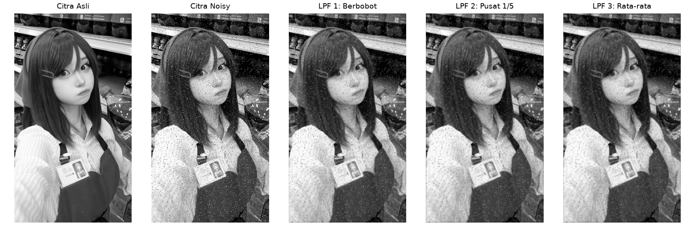
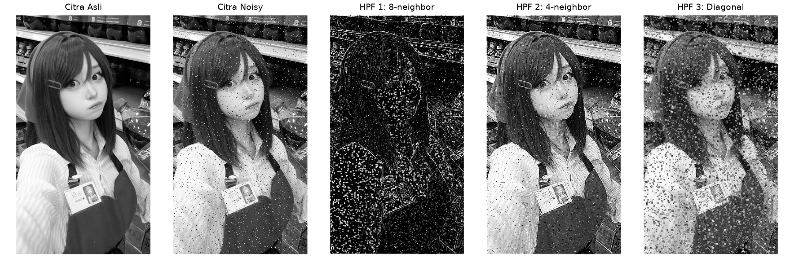

# Tugas 1 - Image Filtering (LPF & HPF)

**Nama:** ........................................  
**NIM:** .........................................  
**Kelas:** .......................................  
**Mata kuliah:** Pengolahan Citra Digital

## Acuan dan lingkungan percobaan

Laporan mengikuti [PRD V2](../PRD-V2.MD) dan implementasi aktual proyek. Dua PDF materi dosen yang disebut PRD tidak tersedia di folder proyek; matriks dan tahapan diambil dari PRD tersebut.

Program menggunakan Python, OpenCV, NumPy, dan Matplotlib melalui terminal. Input adalah `images/living.jpg`, salinan `foto/tayama.jpg`, bukan gambar sintetis ruang tamu. Citra dibaca menggunakan `cv2.IMREAD_GRAYSCALE`, berukuran **597 baris ? 335 kolom**, bertipe **uint8**, dengan intensitas 0?255.

## Persiapan citra dan noise

Seluruh metode memproses citra dengan Salt and Pepper Noise yang sama:

```python
noisy = image.copy()
rng = np.random.default_rng(42)
noise_mask = rng.random(image.shape[:2])
noisy[noise_mask < 0.02] = 0
noisy[noise_mask > 0.98] = 255
```

Probabilitas piksel diberi nilai hitam adalah 2% dan putih 2%, sehingga probabilitas total adalah 4%. Proporsi perubahan aktual dapat berbeda. Salinan citra melindungi input asli dan seed 42 membuat pola noise dapat diulang.

## Tujuan

1. Mengimplementasikan tiga kernel Low Pass Filter dan tiga kernel High Pass Filter sesuai PRD V2.
2. Mengamati pengaruh pembobotan kernel pada noise, tepi, dan detail citra.
3. Membandingkan citra asli, citra noisy, dan tiga hasil pada lima panel.
4. Menyimpan enam citra hasil dan dua figure perbandingan dalam format PNG.

## Dasar teori

LPF mengurangi perubahan intensitas lokal melalui perataan berbobot. Bobot ketiga kernel berjumlah satu sehingga intensitas area konstan dipertahankan di bagian interior citra. Penghalusan juga dapat mengurangi ketajaman detail.

HPF menonjolkan perubahan intensitas. Kernel HPF 1 berjumlah nol sehingga area konstan di interior menghasilkan respons nol. HPF 2 dan HPF 3 berjumlah satu sehingga memiliki komponen intensitas dasar sekaligus penajaman detail. Nama HPF 2 ?4-neighbor? mengikuti PRD; pusatnya bernilai 5, bukan Laplacian murni dengan pusat 4.

## Kernel dan implementasi LPF

Ketiga matriks berukuran 3?3 dan bertipe float32:

```text
LPF 1 = 1/16 ? [1 2 1]    LPF 2 = 1/10 ? [1 1 1]    LPF 3 = 1/9 ? [1 1 1]
              [2 4 2]                   [1 2 1]                  [1 1 1]
              [1 2 1]                   [1 1 1]                  [1 1 1]
```

```python
response = cv2.filter2D(noisy, cv2.CV_32F, kernel,
                        borderType=cv2.BORDER_CONSTANT)
result = np.clip(np.rint(response), 0, 255).astype(np.uint8)
```

LPF 1 memberi bobot lebih besar kepada pusat dan tetangga langsung. LPF 2 memberi bobot pusat 1/5 dan delapan tetangga 1/10. LPF 3 menggunakan bobot seragam 1/9. `np.rint()` membulatkan ke bilangan bulat terdekat; nilai tepat setengah mengikuti pembulatan ke bilangan genap terdekat.

## Kernel dan implementasi HPF

```text
HPF 1 = [-1 -1 -1]    HPF 2 = [ 0 -1  0]    HPF 3 = [ 1 -2  1]
        [-1  8 -1]            [-1  5 -1]            [-2  5 -2]
        [-1 -1 -1]            [ 0 -1  0]            [ 1 -2  1]
```

```python
response = cv2.filter2D(noisy, cv2.CV_32F, kernel,
                        borderType=cv2.BORDER_CONSTANT)
result = np.clip(np.floor(response + 0.5), 0, 255).astype(np.uint8)
```

Respons dihitung dalam float32, lalu dibulatkan dan dibatasi sesuai PRD. Respons negatif menjadi nol, bukan magnitudo absolut. Pembatasan juga menyebabkan nilai di atas 255 menjadi putih. Padding nol pada LPF dan HPF dapat memengaruhi hasil di batas gambar, termasuk menggelapkan batas LPF atau memperkuat respons batas HPF.

## Langkah menjalankan

Dari direktori proyek:

```powershell
python -m pip install -r requirements.txt
python -m filters.low_pass --no-show
python -m filters.high_pass --no-show
```

Hilangkan `--no-show` untuk menampilkan jendela Matplotlib. Lima panel masing-masing figure adalah citra asli, citra noisy, dan tiga hasil filter. Ukuran figure 12?4 inci dengan tampilan grayscale tetap 0?255.

## Hasil LPF



Citra hasil: [LPF 1](../outputs/hasil_lpf1.png), [LPF 2](../outputs/hasil_lpf2.png), dan [LPF 3](../outputs/hasil_lpf3.png).

## Hasil HPF



Citra hasil: [HPF 1](../outputs/hasil_hpf1.png), [HPF 2](../outputs/hasil_hpf2.png), dan [HPF 3](../outputs/hasil_hpf3.png).

## Evaluasi dan pembahasan

MSE dihitung sebagai rata-rata kuadrat selisih piksel hasil terhadap grayscale asli. PSNR dihitung dengan `10 * log10(255**2 / MSE)`. Perhitungan memakai array float64, bukan figure PNG. MSE yang lebih kecil dan PSNR yang lebih besar menunjukkan kedekatan intensitas yang lebih baik terhadap citra asli. Evaluasi ini tidak mewakili semua aspek kualitas visual.

| Citra | MSE | PSNR (dB) |
| --- | ---: | ---: |
| Noisy | 920,7487 | 18,4894 |
| LPF 1 | 195,9968 | 25,2083 |
| LPF 2 | 195,6627 | 25,2157 |
| LPF 3 | 204,0931 | 25,0325 |
| HPF 1 | 14783,2069 | 6,4331 |
| HPF 2 | 1941,6937 | 15,2490 |
| HPF 3 | 5080,5742 | 11,0717 |

Ketiga LPF menurunkan galat terhadap input bersih dibandingkan citra noisy. LPF 2 menghasilkan MSE paling rendah pada percobaan ini, tetapi selisih dengan LPF 1 kecil. Hasil ini hanya berlaku pada citra dan parameter yang diuji.

HPF menghasilkan galat lebih besar daripada citra noisy. Hal ini sesuai karakter operasinya yang menonjolkan perubahan intensitas, termasuk noise impuls. HPF 1 menghasilkan peta respons tepi dengan area konstan gelap, sehingga MSE terhadap citra asli tidak tepat dipakai sebagai satu-satunya ukuran keberhasilan deteksi tepi. HPF 2 dan HPF 3 mempertahankan komponen intensitas dasar, tetapi tetap dapat memperkuat noise dan mengalami clipping.

## Kesimpulan

Ketiga kernel LPF dan HPF berhasil diterapkan sesuai PRD V2 menggunakan perhitungan float32 dan padding nol. LPF memberikan penghalusan, sedangkan HPF menonjolkan tepi dan perubahan intensitas. Pada citra uji dengan Salt and Pepper Noise 4%, LPF 2 memberikan PSNR tertinggi di antara LPF yang diuji. HPF bukan metode penghilangan noise impuls dan hasilnya perlu dinilai sesuai tujuan penajaman atau pengamatan tepi.

## Sumber kode

- [Low Pass Filter](../filters/low_pass.py)
- [High Pass Filter](../filters/high_pass.py)
- [Noise, pembacaan, dan visualisasi](../filters/common.py)
