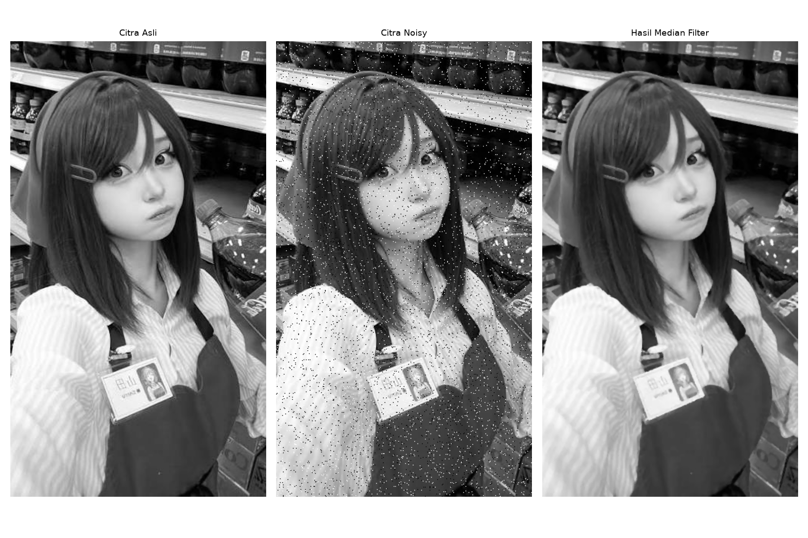
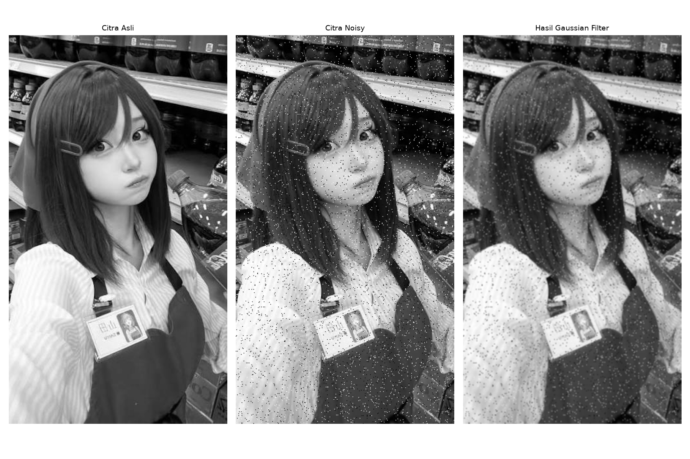

# Tugas 2 - Image Filtering (Median dan Gaussian)

**Nama:** ........................................  
**NIM:** .........................................  
**Kelas:** .......................................  
**Mata kuliah:** Pengolahan Citra Digital

## Acuan dan lingkungan percobaan

Laporan mengikuti [PRD V2](../PRD-V2.MD) dan implementasi aktual proyek. Dua PDF materi dosen yang disebut PRD tidak tersedia di folder proyek; matriks dan tahapan diambil dari PRD tersebut.

Program menggunakan Python, OpenCV, NumPy, dan Matplotlib melalui terminal. Input adalah `images/living.jpg`, salinan `foto/tayama.jpg`, bukan gambar sintetis ruang tamu. Citra dibaca menggunakan `cv2.IMREAD_GRAYSCALE`, berukuran **597 baris ? 335 kolom**, bertipe **uint8**, dengan intensitas 0?255.

## Persiapan citra dan noise

Seluruh metode memproses citra dengan Salt and Pepper Noise yang sama:

```python
noisy = image.copy()
rng = np.random.default_rng(42)
noise_mask = rng.random(image.shape[:2])
noisy[noise_mask < 0.02] = 0
noisy[noise_mask > 0.98] = 255
```

Probabilitas piksel diberi nilai hitam adalah 2% dan putih 2%, sehingga probabilitas total adalah 4%. Proporsi perubahan aktual dapat berbeda. Salinan citra melindungi input asli dan seed 42 membuat pola noise dapat diulang.

## Tujuan

1. Menerapkan Median Filter dan Gaussian Filter pada Salt and Pepper Noise yang identik.
2. Menggunakan kernel 3?3 untuk kedua filter dan sigmaX=1.0 untuk Gaussian.
3. Membandingkan kemampuan kedua metode mengurangi noise dan mempertahankan detail.
4. Menyimpan citra hasil dan visualisasi tiga panel.

## Dasar teori

Median Filter adalah operasi nonlinear yang mengganti piksel dengan nilai median lingkungan lokal. Pada lingkungan 3?3 terdapat sembilan intensitas; setelah diurutkan, nilai kelima menjadi hasil. Nilai impuls hitam atau putih cenderung tersisih jika tidak mendominasi lingkungan tersebut.

Gaussian Filter adalah operasi linear berupa rata-rata berbobot dengan bobot lebih besar di dekat pusat. Bobot berasal dari fungsi `G(x,y) ? exp(-(x?+y?)/(2??))` dan dinormalisasi sehingga jumlahnya satu. Penghalusan meredam fluktuasi intensitas, tetapi piksel impuls tetap berkontribusi pada rata-rata.

Sesuai PRD V2, **Gaussian Filter pada tugas ini menggunakan Salt and Pepper Noise, bukan Gaussian Noise**. Percobaan memakai satu ukuran kernel, bukan variasi 3?3, 5?5, dan 7?7 pada versi awal proyek.

## Implementasi Median Filter

Kode pada `filters/median.py`:

```python
hasil_median = cv2.medianBlur(noisy, 3)
```

Filter diterapkan pada citra noisy hasil prosedur bersama. Keluaran berukuran sama dengan input dan bertipe uint8. File hasil murni disimpan sebagai `outputs/hasil_mf.png`.

## Implementasi Gaussian Filter

Kode pada `filters/gaussian.py`:

```python
hasil_gaussian = cv2.GaussianBlur(noisy, (3, 3), sigmaX=1.0)
```

SigmaX mengatur penyebaran bobot Gaussian. Parameter sigmaY dan border tidak diberikan sehingga menggunakan default OpenCV; berbeda dengan LPF/HPF yang secara eksplisit memakai padding nol. File hasil murni disimpan sebagai `outputs/hasil_gf.png`.

## Visualisasi dan langkah menjalankan

Kedua metode menampilkan tiga panel: citra asli, citra noisy, dan hasil filtering. Figure menggunakan `plt.figure(figsize=(12, 8))` dan `plt.subplot(1, 3, n)`, dengan `cmap="gray"`, `vmin=0`, serta `vmax=255`. Visualisasi disimpan pada 150 dpi sebagai PNG 1800?1200 piksel; citra hasil murni tetap berukuran 597?335 piksel.

```powershell
python -m pip install -r requirements.txt
python -m filters.median --no-show
python -m filters.gaussian --no-show
```

Hilangkan `--no-show` untuk membuka visualisasi. Gunakan `python run_all.py` untuk menjalankan keempat metode proyek. Semua hasil disimpan sebelum runner membuka visualisasi.

## Hasil Median Filter



[Citra hasil Median Filter](../outputs/hasil_mf.png).

## Hasil Gaussian Filter



[Citra hasil Gaussian Filter](../outputs/hasil_gf.png).

## Evaluasi dan pembahasan

MSE dihitung sebagai rata-rata kuadrat selisih piksel hasil terhadap grayscale asli. PSNR dihitung dengan `10 * log10(255**2 / MSE)`. Perhitungan memakai array float64, bukan figure PNG. MSE yang lebih kecil dan PSNR yang lebih besar menunjukkan kedekatan intensitas yang lebih baik terhadap citra asli. Evaluasi ini tidak mewakili semua aspek kualitas visual.

| Citra | MSE | PSNR (dB) |
| --- | ---: | ---: |
| Salt and Pepper Noise, sebelum filter | 920,7487 | 18,4894 |
| Median 3?3 | 47,8009 | 31,3364 |
| Gaussian 3?3, sigmaX=1.0 | 179,3492 | 25,5938 |

Kedua filter menurunkan MSE dibandingkan citra noisy. Median menghasilkan galat lebih kecil dan PSNR lebih tinggi dibandingkan Gaussian pada percobaan yang menggunakan input dan pola noise identik. Hal ini sesuai mekanisme median yang menyingkirkan nilai impuls, sementara Gaussian meratakan kontribusi piksel impuls ke lingkungan lokal.

Median tetap dapat mengubah detail tipis atau struktur kecil. Gaussian menghasilkan penghalusan, tetapi dapat menyisakan pengaruh noise impuls dan mengurangi ketajaman tepi. Hasil percobaan ini tidak membuktikan bahwa Median lebih unggul untuk semua jenis noise; pengujian dibatasi pada satu citra, seed 42, probabilitas noise 4%, dan parameter filter yang ditentukan PRD.

| Aspek | Median | Gaussian |
| --- | --- | --- |
| Operasi | Median lokal, nonlinear | Rata-rata berbobot, linear |
| Kernel | 3?3 | 3?3 |
| SigmaX | Tidak digunakan | 1,0 |
| Noise uji | Salt and Pepper 4% | Salt and Pepper 4% |
| File hasil | `hasil_mf.png` | `hasil_gf.png` |

## Kesimpulan

Median Filter dan Gaussian Filter berhasil diterapkan sesuai PRD V2 dan menghasilkan citra PNG serta visualisasi tiga panel. Pada citra uji dengan Salt and Pepper Noise yang sama, Median 3?3 memperoleh PSNR 31,3364 dB, sedangkan Gaussian 3?3 dengan sigmaX=1.0 memperoleh 25,5938 dB. Median memberikan hasil numerik lebih baik untuk kondisi percobaan ini.

## Sumber kode

- [Median Filter](../filters/median.py)
- [Gaussian Filter](../filters/gaussian.py)
- [Noise, pembacaan, dan visualisasi](../filters/common.py)
- [Runner](../run_all.py)
